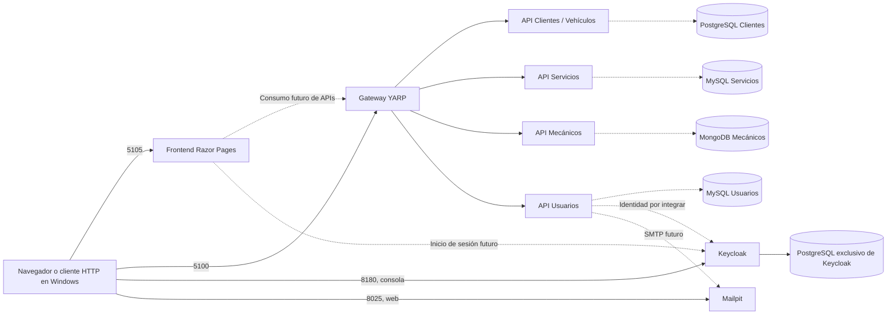
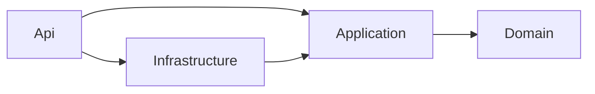

# Guía de desarrollo de AutoTaller Pro EC3

1. [Introducción al proyecto](#introducción-al-proyecto)
2. [Arquitectura general](#arquitectura-general)
3. [Organización del repositorio](#organización-del-repositorio)
4. [Arquitectura interna](#arquitectura-interna)
5. [Responsabilidades del equipo](#responsabilidades-del-equipo)
6. [Infraestructura Docker](#infraestructura-docker)
7. [Instalación desde cero](#instalación-desde-cero)
8. [Conexión a las bases de datos](#conexión-a-las-bases-de-datos)
9. [Gateway YARP](#gateway-yarp)
10. [Desarrollo de microservicios](#desarrollo-de-microservicios)
11. [Desarrollo del Frontend](#desarrollo-del-frontend)
12. [Git y colaboración](#git-y-colaboración)
13. [Seguridad y buenas prácticas](#seguridad-y-buenas-prácticas)
14. [Problemas frecuentes](#problemas-frecuentes)
15. [Estado actual y próximos pasos](#estado-actual-y-próximos-pasos)
16. [Observaciones](#observaciones)

## Introducción al proyecto

AutoTaller Pro EC3 es el entregable de Arquitectura de Software para un sistema de gestión de taller distribuido. Se separó del repositorio anterior para que cada módulo tenga su propia aplicación, capas y datos, y pueda desarrollarse en paralelo con un entorno local reproducible. El repositorio nuevo es independiente de `TallerMecanico`. Usa las bases locales de Compose y mantén fuera del entorno las conexiones a Aiven y los recursos del proyecto anterior.

La base incluye Razor Pages, Gateway YARP, cuatro APIs con salud HTTP y la infraestructura Docker. Inicio, Privacy, Error y la administración visual de Usuarios ya se pueden abrir. El [estado actual](#estado-actual-y-próximos-pasos) distingue las pruebas de infraestructura de las funciones pendientes. La [asignación del equipo](#responsabilidades-del-equipo) indica los entregables de P1 a P6.

## Arquitectura general

En Windows se abre el Frontend en el puerto 5105 y se consulta el Gateway en el 5100. Ambos son aplicaciones independientes. YARP reenvía las peticiones de cada prefijo a su API. Las cuatro APIs responden a `GET /salud`. Cada módulo tiene una base propia y recibe sus parámetros de conexión, que se usarán al implementar persistencia. Keycloak ya usa su propio PostgreSQL. Mailpit ofrece SMTP interno y una bandeja web para futuras pruebas de correo. Las líneas punteadas indican integraciones pendientes.



Compose publica puertos en `127.0.0.1` para herramientas en Windows. Dentro de la red Docker, usa el nombre del servicio y su puerto interno. El `localhost` de un contenedor apunta a ese mismo contenedor. Desde una API en Docker, por ejemplo, el destino es `postgres-clientes:5432`. Desde Windows se usa `127.0.0.1:5433`.

## Organización del repositorio

El árbol muestra las rutas principales. Cada carpeta `Api`, `Application`, `Domain` e `Infrastructure` contiene un `.csproj` con el mismo nombre de la carpeta.

```text
AutoTallerPro-Microservicios/
├── AutoTallerPro.sln
├── Directory.Build.props
├── global.json
├── docker-compose.yml
├── .env.example
├── .dockerignore
├── .gitignore
├── AGENTS.md
├── frontend-app/
│   ├── AutoTallerPro.Frontend.csproj
│   ├── Dockerfile
│   ├── Pages/
│   │   ├── Shared/
│   │   └── Administracion/Usuarios/
│   └── wwwroot/
├── gateway/
│   └── AutoTallerPro.Gateway/
│       ├── AutoTallerPro.Gateway.csproj
│       └── Dockerfile
├── microservices/
│   ├── clientes-vehiculos/
│   │   ├── AutoTallerPro.ClientesVehiculos.Api/
│   │   ├── AutoTallerPro.ClientesVehiculos.Application/
│   │   ├── AutoTallerPro.ClientesVehiculos.Domain/
│   │   └── AutoTallerPro.ClientesVehiculos.Infrastructure/
│   ├── servicios/
│   │   ├── AutoTallerPro.Servicios.Api/
│   │   ├── AutoTallerPro.Servicios.Application/
│   │   ├── AutoTallerPro.Servicios.Domain/
│   │   └── AutoTallerPro.Servicios.Infrastructure/
│   ├── mecanicos/
│   │   ├── AutoTallerPro.Mecanicos.Api/
│   │   ├── AutoTallerPro.Mecanicos.Application/
│   │   ├── AutoTallerPro.Mecanicos.Domain/
│   │   └── AutoTallerPro.Mecanicos.Infrastructure/
│   └── usuarios/
│       ├── AutoTallerPro.Usuarios.Api/
│       ├── AutoTallerPro.Usuarios.Application/
│       ├── AutoTallerPro.Usuarios.Domain/
│       └── AutoTallerPro.Usuarios.Infrastructure/
├── shared/Contracts/
│   └── AutoTallerPro.Contracts.csproj
├── infra/
│   ├── README.md
│   └── mongo/crear-usuario.js
├── tests/
│   └── .gitkeep
└── docs/
    ├── arquitectura.md
    └── GUIA_DESARROLLO.md
```

| Ruta | Responsabilidad actual |
| --- | --- |
| `frontend-app/` | Interfaz Razor Pages, layout y recursos estáticos. |
| `gateway/` | Proxy HTTP YARP y definición de sus destinos. |
| `microservices/` | Cuatro módulos de negocio con una API ejecutable por módulo. |
| `shared/Contracts/` | Biblioteca reservada para contratos compartidos. Está vacía y ningún proyecto la referencia. |
| `infra/` | Guía de Docker e inicialización de la cuenta de aplicación de MongoDB. |
| `tests/` | Carpeta reservada. Actualmente contiene `.gitkeep`. |
| `docs/` | Guías del equipo y decisiones arquitectónicas. |

[AutoTallerPro.sln](../AutoTallerPro.sln) agrupa 19 proyectos para navegar, compilar y verificar referencias en conjunto. Cuatro representan los microservicios de negocio. Seis proyectos son ejecutables web. Los otros 13 son las 12 bibliotecas de capas y la biblioteca compartida. [Directory.Build.props](../Directory.Build.props) fija `net10.0`, referencias anulables e imports implícitos. [global.json](../global.json) parte de SDK `10.0.100` y admite bandas estables posteriores de .NET 10 mediante `latestFeature`.

## Arquitectura interna

| Capa | Responsabilidad al implementar cada módulo |
| --- | --- |
| `Api` | Entrada HTTP. Aloja los endpoints y configura la inyección de dependencias en su `Program.cs`. Es el único proyecto ejecutable del módulo. |
| `Application` | Casos de uso y puertos o interfaces que necesita la aplicación. |
| `Domain` | Entidades y reglas propias del negocio, independientes de infraestructura y frameworks. |
| `Infrastructure` | Implementaciones de los puertos, conexiones a la base y adaptadores técnicos. |



Las flechas son referencias directas verificadas en los cuatro módulos. `Domain` carece de referencias a otras capas. No agregues dependencias de las capas internas hacia HTTP o persistencia. La referencia `Api` → `Infrastructure` permite componer las implementaciones concretas.

Clientes/Vehículos y Servicios usan esta división para Arquitectura Hexagonal, con HTTP como entrada y persistencia como salida del núcleo. En Mecánicos las mismas fronteras organizan Clean Architecture y sus dependencias apuntan hacia el núcleo. Usuarios usa la misma división de proyectos. La responsabilidad exacta de su dominio frente a Keycloak se acordará al integrar identidad. Véase [arquitectura.md](arquitectura.md).

## Responsabilidades del equipo

| Rol | Responsabilidad |
| --- | --- |
| P1 · Clientes/Vehículos | Arquitectura Hexagonal y PostgreSQL. CRUD de Clientes y Vehículos y sus páginas Razor. |
| P2 · Servicios | Arquitectura Hexagonal y MySQL. Solo CRUD de Servicios y su Frontend. |
| P3 · Mecánicos | Clean Architecture y MongoDB. CRUD de Mecánicos y su Frontend. |
| P4 · Usuarios Backend | MySQL, gestión de usuarios, integración con Keycloak, autenticación y auditoría de acuerdo con los requisitos del módulo. |
| P5 · Usuarios Frontend | Conectar las vistas Razor existentes con la gestión de usuarios y desarrollar los flujos de autenticación acordados con P4. |
| P6 · Integración e infraestructura | Gateway, Docker, coordinación de servicios, integración, pruebas y documentación. |

Result y Adapter se incorporarán más adelante. Órdenes, Productos y Reportes quedan fuera del alcance funcional actual. La disponibilidad de un nombre en el menú indica su ubicación prevista.

## Infraestructura Docker

[Compose](../docker-compose.yml) declara el proyecto `autotaller-ec3`. Los nombres de la primera columna también son los DNS de la red `autotaller-ec3_default`, de tipo bridge. La publicación indicada es el valor inicial en `127.0.0.1`.

| Servicio y DNS | Responsabilidad | Imagen | Puerto interno | Windows |
| --- | --- | --- | --- | --- |
| `frontend` | Servir la interfaz Razor | `autotaller-ec3-frontend` | 8080 | 5105 |
| `gateway` | Enrutar por YARP | `autotaller-ec3-gateway` | 8080 | 5100 |
| `ms-clientes` | API Clientes/Vehículos | `autotaller-ec3-ms-clientes` | 8080 | 5101 |
| `ms-servicios` | API Servicios | `autotaller-ec3-ms-servicios` | 8080 | 5102 |
| `ms-mecanicos` | API Mecánicos | `autotaller-ec3-ms-mecanicos` | 8080 | 5103 |
| `ms-usuarios` | API Usuarios | `autotaller-ec3-ms-usuarios` | 8080 | 5104 |
| `postgres-clientes` | Datos de Clientes/Vehículos | `postgres:17` | 5432 | 5433 |
| `mysql-servicios` | Datos de Servicios | `mysql:8.4` | 3306 | 3307 |
| `mongo-mecanicos` | Datos de Mecánicos | `mongo:8.0` | 27017 | 27018 |
| `mysql-usuarios` | Datos del módulo Usuarios | `mysql:8.4` | 3306 | 3308 |
| `postgres-keycloak` | Datos internos de Keycloak | `postgres:17` | 5432 | Sin publicación |
| `keycloak` | Servidor de identidad en modo desarrollo | `quay.io/keycloak/keycloak:26.8.2` | 8080 web, 9000 disponibilidad | 8180 web |
| `mailpit` | Correo de desarrollo | `axllent/mailpit:v1.33.1` | 8025 web, 1025 SMTP | 8025 web |

Cada aplicación tiene su propio Dockerfile. Usa la raíz como contexto, publica en Release con `mcr.microsoft.com/dotnet/sdk:10.0` y ejecuta en `mcr.microsoft.com/dotnet/aspnet:10.0` como usuario sin privilegios. [.dockerignore](../.dockerignore) excluye credenciales, archivos de entorno y salidas de compilación, entre otros archivos locales.

Compose comprueba PostgreSQL y MySQL con `SELECT 1`, y MongoDB con un ping autenticado. Keycloak espera a `postgres-keycloak` mediante `service_healthy` y comprueba `/health/ready` en el puerto 9000. Mailpit comprueba `readyz`. Las seis aplicaciones no declaran healthcheck en Compose ni dependen del arranque de una base. Para ellas, verifica la respuesta HTTP además del estado `running`.

Hay siete volúmenes con prefijo `autotaller-ec3_`. Cinco almacenan las cinco bases por separado (`postgres-clientes-data`, `mysql-servicios-data`, `mongo-mecanicos-data`, `mysql-usuarios-data` y `postgres-keycloak-data`). `mongo-mecanicos-config` conserva `/data/configdb` y `mailpit-data` guarda la bandeja bajo `/data`. `docker compose stop` conserva los volúmenes. Véase la [guía de infraestructura](../infra/README.md).

## Instalación desde cero

### Primera vez en Windows 10 u 11

1. Ten a mano una cuenta con acceso al repositorio GitHub y espacio para las imágenes y volúmenes. Usa VS Code con soporte de C# si vas a desarrollar.
2. Instala Git si te falta. Abre una nueva terminal PowerShell y comprueba `git --version`. [Git para Windows](https://git-scm.com/install/windows).
3. Instala Docker Desktop para tu versión de Windows con WSL 2 según los requisitos oficiales. Ábrelo y espera al motor. Este proyecto requiere **contenedores Linux**. [Instalación de Docker Desktop en Windows](https://docs.docker.com/desktop/setup/install/windows-install/).
4. Instala el **SDK** .NET 10 estable si vas a compilar, depurar o ejecutar desde Windows. Para levantar todo con Compose basta Docker Desktop, porque las imágenes de compilación incluyen el SDK. Comprueba `dotnet --list-sdks` y, desde el repositorio, `dotnet --version`. [Instalación del SDK en Windows](https://learn.microsoft.com/en-us/dotnet/core/install/windows).

En PowerShell ejecuta las comprobaciones de Docker y clona desde tu carpeta de trabajo. `docker version` debe mostrar el servidor y `docker info` debe devolver `linux`.

```powershell
git --version
docker version
docker compose version
docker info --format '{{.OSType}}'
git clone https://github.com/santiagotorresv/AutoTallerPro-Microservicios.git
Set-Location AutoTallerPro-Microservicios
code .
```

Si `code` no está en tu PATH, abre la carpeta desde el menú de VS Code. Usa su terminal PowerShell en la raíz, donde están `AutoTallerPro.sln` y `docker-compose.yml`.

Crea el archivo local una sola vez y ábrelo para editarlo en tu equipo.

```powershell
if (-not (Test-Path -LiteralPath '.env')) {
    Copy-Item -LiteralPath '.env.example' -Destination '.env'
}
code .env
git check-ignore -- .env
```

Sustituye cada valor de ejemplo de las variables que terminan en `_PASSWORD` por una contraseña aleatoria distinta. Mantén los nombres y cuentas de la plantilla, o coordina cambios antes de inicializar volúmenes. Usa `KEYCLOAK_BOOTSTRAP_ADMIN_USERNAME` y `KEYCLOAK_BOOTSTRAP_ADMIN_PASSWORD` para la cuenta inicial. Los puertos de infraestructura se pueden ajustar con sus variables `_PORT` si están ocupados. Ajusta también la dirección que uses desde Windows si cambias uno. Los puertos publicados por las aplicaciones .NET están fijos en Compose y cualquier cambio se coordina con P6. Consulta [.env.example](../.env.example).

Comprueba puertos, valida, compila, levanta y revisa el estado.

```powershell
docker ps
docker compose config --quiet
docker compose build
docker compose up -d --wait --wait-timeout 240
docker compose ps
```

Espera siete servicios de infraestructura saludables y seis aplicaciones en ejecución. Abre [Inicio](http://127.0.0.1:5105/), prueba [la salud de Mecánicos por Gateway](http://127.0.0.1:5100/api/mecanicos/salud), abre [la consola de Keycloak](http://127.0.0.1:8180/admin/) con la cuenta inicial de tu archivo local y revisa [Mailpit](http://127.0.0.1:8025/). Las direcciones locales requieren tener los servicios levantados. La raíz del Gateway carece de una ruta propia. Un 404 allí es esperado.

### Uso cotidiano

```powershell
# Reanudar después de detener.
docker compose up -d --wait --wait-timeout 240
docker compose ps

# Detener conservando contenedores y volúmenes.
docker compose stop
```

Para un cambio de código reconstruye solo el servicio afectado, como se muestra en [Desarrollo de microservicios](#desarrollo-de-microservicios). Evita ejecutar un proyecto con el SDK y su contenedor en el mismo puerto.

## Conexión a las bases de datos

| Módulo | Host y puerto Docker | Host y puerto Windows | Variables del archivo local |
| --- | --- | --- | --- |
| Clientes/Vehículos | `postgres-clientes:5432` | `127.0.0.1:5433` | `POSTGRES_CLIENTES_DB`, `POSTGRES_CLIENTES_USER`, `POSTGRES_CLIENTES_PASSWORD`, `POSTGRES_CLIENTES_PORT` |
| Servicios | `mysql-servicios:3306` | `127.0.0.1:3307` | `MYSQL_SERVICIOS_DB`, `MYSQL_SERVICIOS_USER`, `MYSQL_SERVICIOS_PASSWORD`, `MYSQL_SERVICIOS_PORT` |
| Mecánicos | `mongo-mecanicos:27017` | `127.0.0.1:27018` | `MONGO_MECANICOS_DB`, `MONGO_MECANICOS_USER`, `MONGO_MECANICOS_PASSWORD`, `MONGO_MECANICOS_PORT` |
| Usuarios | `mysql-usuarios:3306` | `127.0.0.1:3308` | `MYSQL_USUARIOS_DB`, `MYSQL_USUARIOS_USER`, `MYSQL_USUARIOS_PASSWORD`, `MYSQL_USUARIOS_PORT` |

En pgAdmin, MySQL Workbench o MongoDB Compass usa el host y puerto de Windows junto con el nombre, usuario y contraseña de la fila. Una aplicación ejecutada con `dotnet run` deberá recibir esos parámetros mediante su configuración local cuando implemente persistencia. El SDK no carga automáticamente el `.env` de Compose. Otro contenedor de la misma red usa el host y puerto internos y las credenciales de su propia base.

Compose traduce esos valores a `Database__Host`, `Database__Port`, `Database__Name`, `Database__User` y `Database__Password` en la API correspondiente. ASP.NET Core los expone bajo `Database:*`. Para MongoDB añade `Database__AuthSource`, con el mismo valor que `MONGO_MECANICOS_DB`. En Compass selecciona esa base como base de autenticación. En una URI añade `?authSource=<base>` y codifica los caracteres reservados del usuario y la contraseña.

Las cuentas root se reservan para administración. [El script de MongoDB](../infra/mongo/crear-usuario.js) crea la cuenta de aplicación con `readWrite` en su base al inicializar el volumen. El PostgreSQL `postgres-keycloak` es exclusivo del servidor de identidad y usa las variables `POSTGRES_KEYCLOAK_DB`, `POSTGRES_KEYCLOAK_USER` y `POSTGRES_KEYCLOAK_PASSWORD`. La persistencia de negocio de Usuarios corresponde a `mysql-usuarios`.

Para comprobar conectividad sin escribir datos, revisa el estado, prueba el puerto desde Windows y ejecuta `SELECT 1` desde un cliente SQL con la cuenta de aplicación. Para MongoDB ejecuta `db.runCommand({ping: 1})` tras autenticarte. Los healthchecks existentes también ejecutan esas pruebas desde Docker.

```powershell
docker compose ps postgres-clientes mysql-servicios mongo-mecanicos mysql-usuarios postgres-keycloak
5433, 3307, 27018, 3308 | ForEach-Object {
    Test-NetConnection -ComputerName 127.0.0.1 -Port $_ -InformationLevel Quiet
}
```

Cada responsable implementará drivers, mapeos, modelos, tablas o colecciones y repositorios de su propio módulo. Las APIs actuales solo exponen salud HTTP, aunque reciban los parámetros de Docker.

## Gateway YARP

[Program.cs](../gateway/AutoTallerPro.Gateway/Program.cs) carga `ReverseProxy` de la configuración y llama a `MapReverseProxy`. [appsettings.json](../gateway/AutoTallerPro.Gateway/appsettings.json) define las rutas y usa los destinos locales para ejecución con el SDK. Compose sobrescribe sus direcciones con `ReverseProxy__Clusters__<servicio>__Destinations__principal__Address`.

| Prefijo | Destino en Compose |
| --- | --- |
| `/api/clientes-vehiculos/{**catch-all}` | `http://ms-clientes:8080/` |
| `/api/servicios/{**catch-all}` | `http://ms-servicios:8080/` |
| `/api/mecanicos/{**catch-all}` | `http://ms-mecanicos:8080/` |
| `/api/usuarios/{**catch-all}` | `http://ms-usuarios:8080/` |

`PathRemovePrefix` elimina el prefijo del módulo. Por ejemplo, `GET /api/mecanicos/salud` se reenvía como `GET http://ms-mecanicos:8080/salud`.

Gateway usa JWT Bearer y obtiene las claves de firma desde el JWKS anunciado por Keycloak. Valida la firma, el emisor exacto `http://127.0.0.1:8180/realms/autotaller`, la audiencia `autotaller-api` y la vigencia. Acepta access tokens de Keycloak con `typ` igual a `Bearer` y lee los roles de negocio de `realm_access.roles`. En Docker usa el discovery interno de `keycloak:8080`. Al usar el perfil `http` del SDK en Windows, el discovery deriva del emisor público. Los metadatos HTTP se permiten en `Development`. Véase la [configuración de audiencia en Keycloak](../infra/keycloak/README.md#audiencia-de-las-api).

Los cuatro GET `/api/<módulo>/salud` son anónimos y sus rutas tienen prioridad sobre las generales. Las demás solicitudes bajo esos prefijos requieren la política `PersonalAutorizado`, que admite `Administrador` y `Recepcionista`. La política `SoloAdministrador` queda disponible para futuros endpoints que lo requieran. Usuarios aplica por ahora la política general. Gateway responde 401 cuando falta un access token válido y 403 cuando el usuario autenticado carece del rol requerido. Una solicitud autorizada puede recibir 404 de la API si el endpoint todavía no existe.

Las APIs siguen accesibles directamente en los puertos publicados de Compose y esa conexión evita la validación de Gateway. P1–P4 deben incorporar validación de access tokens y políticas en sus propias APIs, coordinar la audiencia y acordar las operaciones de cada rol. La autorización de cada API debe usar los claims del token validado.

```powershell
'clientes-vehiculos', 'servicios', 'mecanicos', 'usuarios' | ForEach-Object {
    Invoke-RestMethod "http://127.0.0.1:5100/api/$_/salud"
}
```

Cada respuesta esperada es `{"estado":"OK"}` con HTTP 200. La prueba confirma enrutamiento y respuesta de la API. La disponibilidad de la base se verifica por separado.

## Desarrollo de microservicios

1. Entra al directorio de tu módulo bajo `microservices/`. Revisa los endpoints y las referencias antes de crear archivos.
2. Coloca endpoints o controladores en `Api`. Hoy cada API usa un endpoint mínimo en `Program.cs`. Si introduces controladores, configura explícitamente su registro y mapeo al implementar la funcionalidad.
3. Coloca casos de uso y los puertos de persistencia que necesiten en `Application`, y entidades y reglas puras en `Domain`.
4. Coloca el driver, la implementación de repositorios y el acceso a configuración de base en `Infrastructure`. Conserva las credenciales en configuración local o de ejecución. Registra los casos de uso y sus implementaciones mediante inyección de dependencias desde `Api/Program.cs`, o invoca desde allí un método de registro de la capa concreta si el módulo lo necesita.
5. Mantén las referencias del diagrama. Si hace falta un contrato público compartido, acuerda su forma con el equipo antes de cambiar `shared/Contracts/`. Los módulos se integrarán por sus interfaces públicas.

Ejecuta desde la raíz el `dotnet build` que corresponda. Cada proyecto arrastra sus bibliotecas por referencia.

```powershell
dotnet build microservices/clientes-vehiculos/AutoTallerPro.ClientesVehiculos.Api/AutoTallerPro.ClientesVehiculos.Api.csproj
dotnet build microservices/servicios/AutoTallerPro.Servicios.Api/AutoTallerPro.Servicios.Api.csproj
dotnet build microservices/mecanicos/AutoTallerPro.Mecanicos.Api/AutoTallerPro.Mecanicos.Api.csproj
dotnet build microservices/usuarios/AutoTallerPro.Usuarios.Api/AutoTallerPro.Usuarios.Api.csproj
```

Para reconstruir Servicios con Docker y comprobarlo, por ejemplo, mantén el Gateway y la infraestructura ya levantados. Para otro módulo cambia el nombre del servicio y usa los puertos y rutas de las tablas.

```powershell
docker compose up -d --build --no-deps ms-servicios
docker compose ps ms-servicios
docker compose logs --tail 80 ms-servicios
Invoke-RestMethod http://127.0.0.1:5102/salud
Invoke-RestMethod http://127.0.0.1:5100/api/servicios/salud
```

Para depuración con el SDK, detén el contenedor de la aplicación cuyo puerto vas a ocupar. Puedes mantener sus dependencias de infraestructura en Docker. Consulta los perfiles y comandos en el [README raíz](../README.md).

## Desarrollo del Frontend

En `frontend-app/Pages/`, un `.cshtml` define el HTML y la presentación de una página Razor. Su `.cshtml.cs` contiene el PageModel cuando hace falta lógica de página. `Pages/Shared/_Layout.cshtml` define menú y encabezado. `_ViewStart.cshtml` selecciona el layout y `_ViewImports.cshtml` comparte namespaces y tag helpers. `wwwroot/css/`, `wwwroot/js/`, `wwwroot/images/` y `wwwroot/lib/` alojan los recursos estáticos.

Ya están Inicio, Privacy, Error y el listado, creación y edición visual de Usuarios en `Pages/Administracion/Usuarios/`. Editar conserva `/Administracion/Usuarios/Editar/{id:int}`. Esas pantallas de Usuarios no tienen registros reales ni operaciones conectadas. El menú habilita Usuarios bajo Personal. P1, P2 y P3 desarrollarán sus propias páginas.

Al incorporar páginas de un módulo, reutiliza el layout, los recursos y la tipografía existentes. Mantén los estilos específicos en el módulo correspondiente y coordina cambios al menú o a `site.css`. En una integración futura, un cliente HTTP del Frontend ejecutado en Docker podrá usar `http://gateway:8080/api/<módulo>/`. Desde un proceso de Frontend en Windows usará la dirección publicada del Gateway. Un navegador de Windows tampoco resuelve DNS internos de Compose. Define flujos de autenticación con P4 y P5 antes de habilitar operaciones de Usuarios. Véase el [README del Frontend](../frontend-app/README.md).

## Git y colaboración

Clona mediante el comando de [instalación](#instalación-desde-cero). Trabaja en una rama propia desde `main`. Usa estas referencias y acuerda nombres distintos para tareas simultáneas.

| Rol | Rama de referencia |
| --- | --- |
| P1 | `feature/clientes-vehiculos` |
| P2 | `feature/servicios` |
| P3 | `feature/mecanicos` |
| P4 | `feature/usuarios-backend` |
| P5 | `feature/usuarios-frontend` |
| P6, integración coordinada con P4 y P5 | `feature/integracion-keycloak` |

Ejemplo para Servicios. Antes de cambiar de rama revisa que hayas guardado tu trabajo y que el archivo local esté ignorado.

```powershell
git status --short --branch
git switch main
git pull --ff-only origin main
git switch -c feature/servicios
git branch --show-current

# Después de editar y probar.
git diff
git add -- microservices/servicios
git diff --cached
git commit -m "Describe el cambio de Servicios"
git push -u origin feature/servicios
```

Agrega también los archivos específicos de tu Frontend cuando corresponda, con rutas explícitas. Abre un Pull Request en GitHub con `main` como base y tu rama como origen. Describe qué cambia, cómo se comprobó y qué depende de otros módulos. Pide revisión a los responsables de los archivos compartidos.

Para actualizar tu rama, con tus cambios ya registrados, usa `git fetch origin` seguido de `git merge origin/main` desde tu rama. Si hay conflictos, revisa `git status`, abre los archivos en el editor de combinación de VS Code y conserva los cambios compatibles de ambos lados. Coordina con el autor si dos cambios tienen efectos incompatibles. Después de verificar, registra los archivos resueltos con `git add` y concluye con `git merge --continue`. Si necesitas cancelar el intento, usa `git merge --abort` antes de concluir la combinación. Mantén `main` como destino de PR y evita reescribir ramas compartidas.

Acuerda de antemano con P6 cambios en `docker-compose.yml` y Gateway. En Frontend coordina los archivos del layout con los demás responsables y limita los cambios visuales a la carpeta y recursos del módulo. Haz PR pequeños con un alcance claro.

## Seguridad y buenas prácticas

- Conserva `.env` en tu equipo y verifica `git check-ignore -- .env` y `git diff --cached`. Usa [.env.example](../.env.example) para documentar variables con valores de muestra. Mantén fuera de Git claves privadas, certificados locales y credenciales de bases, SMTP o identidad.
- Usa exclusivamente las cuentas y bases locales del módulo. Evita conexiones a Aiven y operaciones, migraciones o borrados sobre bases de terceros.
- Coordina cambios de Compose y Gateway con P6. Usa `docker compose stop` para conservar los datos. Evita `docker compose down -v`, `docker system prune` y otros comandos que borren volúmenes.
- Conserva la dirección de dependencias y la autonomía de cada módulo. Agrega solo los paquetes y referencias necesarios para el cambio y justifica las decisiones arquitectónicas.
- Este entorno es de desarrollo local y publica HTTP en loopback. En producción harán falta otra configuración de identidad, HTTPS, secretos y despliegue.

## Problemas frecuentes

| Síntoma | Diagnóstico y acción |
| --- | --- |
| Docker no responde | Abre Docker Desktop, espera el motor y valida `docker version`, `docker context show` y `docker info --format '{{.OSType}}'`. Usa contenedores Linux. |
| Puerto ocupado | Consulta `docker ps` y, por ejemplo, `Get-NetTCPConnection -State Listen -LocalPort 5105`. Detén únicamente tu proceso si corresponde. Para infraestructura, usa su variable `_PORT`. Coordina los puertos fijos de las aplicaciones. |
| Contenedor no saludable | Consulta `docker compose ps` y `docker compose logs --tail 80 <servicio>`. Verifica primero la dependencia de PostgreSQL si falla Keycloak. |
| Fallo de autenticación de base | Comprueba usuario, base, puerto y `authSource` en MongoDB. Las variables iniciales se aplican al crear el volumen. Para una base existente, coordina la rotación de la cuenta y actualiza tu `.env`. |
| Fallo de conexión entre contenedores | Confirma que comparten la red y que el destino está en ejecución. Dentro de Docker usa DNS y puerto interno. `localhost` apunta al contenedor que hace la petición. |
| Cambios de código ausentes en Docker | Comprueba en qué puerto estás probando. Reconstruye el servicio afectado con `docker compose up -d --build --no-deps <servicio>` y revisa sus logs. |
| Gateway devuelve 404 | Prueba la ruta directa tras quitar el prefijo. Comprueba el prefijo público y si el endpoint existe. La raíz del Gateway no tiene ruta. |
| Gateway devuelve 502 o 503 | Comprueba primero `docker compose ps` y la salud directa. Revisa `docker compose logs --tail 80 gateway` y el destino efectivo. Si el servicio directo también responde 503, diagnostica esa API. |
| Keycloak no carga | Prueba el puerto publicado y espera su healthcheck. Consulta `docker compose logs --tail 80 keycloak postgres-keycloak`. Usa las credenciales iniciales de la instancia local. |
| Variables faltantes | Confirma la ubicación de `.env`, los nombres de [.env.example](../.env.example) y la salida de `docker compose config --quiet`. Evita compartir la salida de `config` sin `--quiet`. |
| La solución no compila | Desde la raíz ejecuta `dotnet --list-sdks` y `dotnet --version`. Comprueba la versión en [global.json](../global.json). Ejecuta `dotnet restore AutoTallerPro.sln` y `dotnet build AutoTallerPro.sln --no-restore`. Atiende el primer error del proyecto que lo genera. |
| El registro interrumpe la descarga | Revisa si Docker Desktop tiene acceso al registro. Para las imágenes de infraestructura, prueba `docker compose --parallel 1 pull --ignore-buildable` antes de volver a levantar. |

## Estado actual y próximos pasos

| Estado | Alcance |
| --- | --- |
| Implementado y probado | Solución de 19 proyectos, seis imágenes .NET, Inicio y vistas Razor existentes, cuatro respuestas `/salud` directas y por Gateway, red y volúmenes Docker, realm y cliente OIDC de Keycloak, invitaciones por Mailpit y validación JWT con políticas en Gateway. |
| Preparado, pendiente de implementación | CRUD y persistencia de los cuatro módulos, Frontends de P1/P2/P3, integración de Usuarios, login y logout de Razor, validación y autorización en cada API, auditoría, Result y Adapter, pruebas de integración y documentación final. |
| Fuera del alcance funcional actual | Órdenes, Productos y Reportes. El uso de Aiven y de la infraestructura anterior queda fuera del entorno EC3. |

## Observaciones

- Frontend y Gateway emitieron avisos de Data Protection en la Etapa 3B. Las claves se generan en el contenedor y no tienen un almacenamiento persistente ni cifrado configurado. Revisa su persistencia y protección al implementar sesiones y autenticación.
- Falta acordar la frontera entre los datos propios de Usuarios en MySQL y los administrados por Keycloak, así como el contrato de identidad entre P4 y P5.
- `.dockerignore` excluye `appsettings.*.json` del contexto actual. Si un módulo necesita en el futuro un archivo por entorno dentro de la imagen, acuerda su inclusión con P6 y conserva los secretos en configuración de ejecución.
