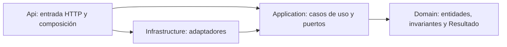
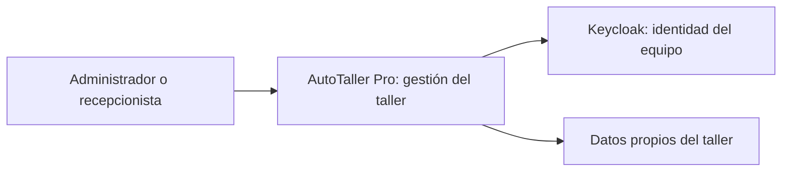
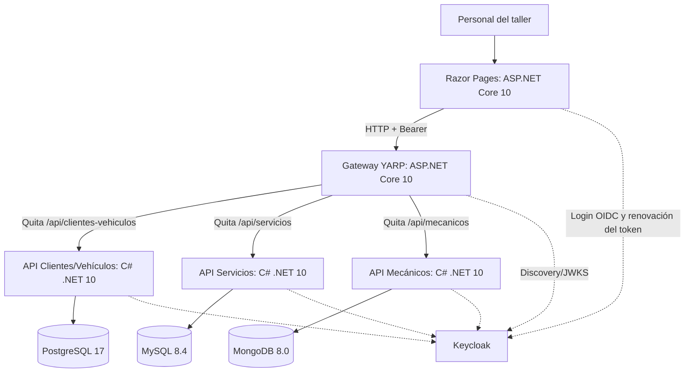
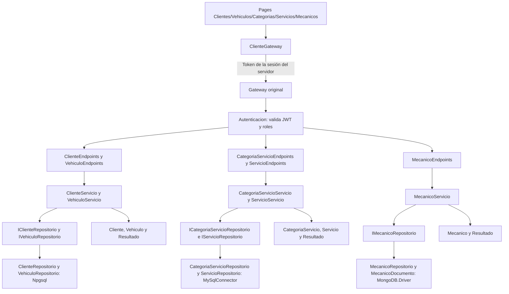
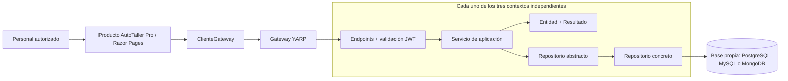
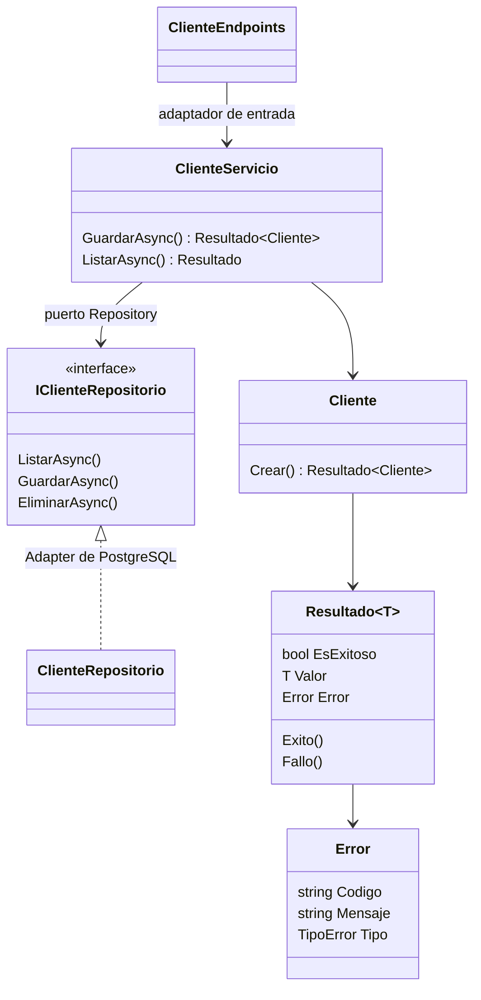
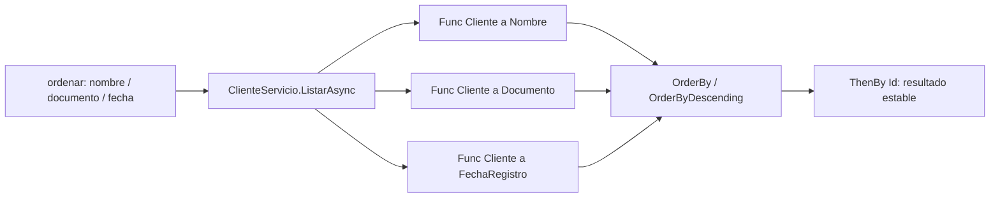

# Arquitectura del Grupo 1

## Contextos y dependencias

Clientes/Vehículos gestiona propietarios y sus vehículos. Catálogo administra categorías y servicios ofrecidos,
sin representar órdenes de trabajo. Mecánicos administra información laboral; no crea cuentas de Keycloak.
Cada API conoce únicamente su base y no referencia otro microservicio.

P1/P2 son hexagonales: `*Endpoints` constituye el adaptador de entrada; `*Servicio` implementa los casos de uso;
`I*Repositorio` expresa puertos de salida y `*Repositorio` implementa adaptadores PostgreSQL/MySQL.
P3 usa Clean Architecture: presentación en Api, casos de uso y puertos en Application, entidades en Domain y MongoDB en Infrastructure.
El documento BSON es un modelo de infraestructura diferente de la entidad de dominio. Las entidades carecen de dependencias de drivers o HTTP.

## C4 nivel 1 · Contexto

El contexto describe el producto integrado: el Frontend inicia sesión con Keycloak (P4/P5) y envía el access token al Gateway.

## C4 nivel 2 · Contenedores

Las bases se ejecutan en los servicios propios de Compose, con cuentas y almacenamiento separados.
Las pruebas utilizan contenedores adicionales con directorios de datos tmpfs, puertos aleatorios y nombres únicos;
no montan los volúmenes del equipo.

## C4 nivel 3 · Componentes

## Combinación de niveles 1–3

## Patrones implementados

| Patrón | Problema y clases reales | Evidencia |
| --- | --- | --- |
| Adapter | Transformar HTTP y operaciones de persistencia a los contratos del núcleo. | `Api/Adaptadores/*Endpoints.cs`, `Infrastructure/Persistencia/*Repositorio.cs`, `MecanicoDocumento`. |
| Result | Rechazar reglas esperadas sin excepciones de negocio y conservar códigos tipados. | `Domain/Resultados/Resultado.cs`, `Error`, `TipoError`; conversión en `Respuestas.Http`. |
| Repository | Ofrecer colecciones de entidades al caso de uso sin exponer SQL, BSON o conexiones. | `Application/Puertos/I*Repositorio.cs` y sus adaptadores concretos. |
| Strategy mediante delegados | Elegir el criterio de ordenación por nombre, identificador, fecha, precio o duración. | `Func<Entidad, IComparable> clave`, seleccionado por `ordenar` en `ListarAsync`; `OrderBy`/`OrderByDescending` aplica la estrategia. |

Repository y Strategy son independientes de Adapter: el primero define el acceso a agregados;
el segundo representa algoritmos de comparación intercambiables sin clases artificiales.
Las fábricas estáticas `Crear` mantienen invariantes; no se contabilizan como Factory Method GoF.
La inyección de dependencias no se contabiliza como un patrón adicional.

## SOLID y Clean Code

- SRP: las entidades validan datos propios; los servicios coordinan relaciones; los repositorios acceden a datos; `Respuestas` traduce resultados HTTP.
- OCP: un adaptador alternativo puede implementar el puerto sin cambiar el caso de uso; la interfaz de entrada no conoce el driver.
- LSP: las pruebas de casos de uso sustituyen los puertos por repositorios de prueba. Las restricciones de proveedor se verifican por separado contra bases reales.
- ISP: cada agregado dispone de un puerto concreto; no hay repositorio genérico con operaciones ajenas al negocio.
- DIP: los servicios reciben interfaces de Application; el único enlace con los adaptadores concretos ocurre en la raíz de composición Api.

Las reglas de entidad se concentran en `Crear`; SQL usa parámetros y los resultados de escritura se comprueban.
Los rechazos de duplicidad producidos por restricciones concurrentes también se convierten a Result.
Los errores inesperados devuelven 500 y no se presentan como operaciones exitosas.

## Límites

La selección y ordenación se ejecutan en Application después de consultar las colecciones del módulo.
Esto cubre la evaluación y mantiene criterios uniformes entre proveedores; para grandes volúmenes falta paginación y ordenación en servidor.
No hay control de versión para resolver dos ediciones simultáneas: prevalece la última actualización.
Las referencias a clientes/categorías inactivos se rechazan al crear o editar el registro hijo.
No se incluye comunicación con órdenes, cuentas de usuario o bitácora del Grupo 2.
