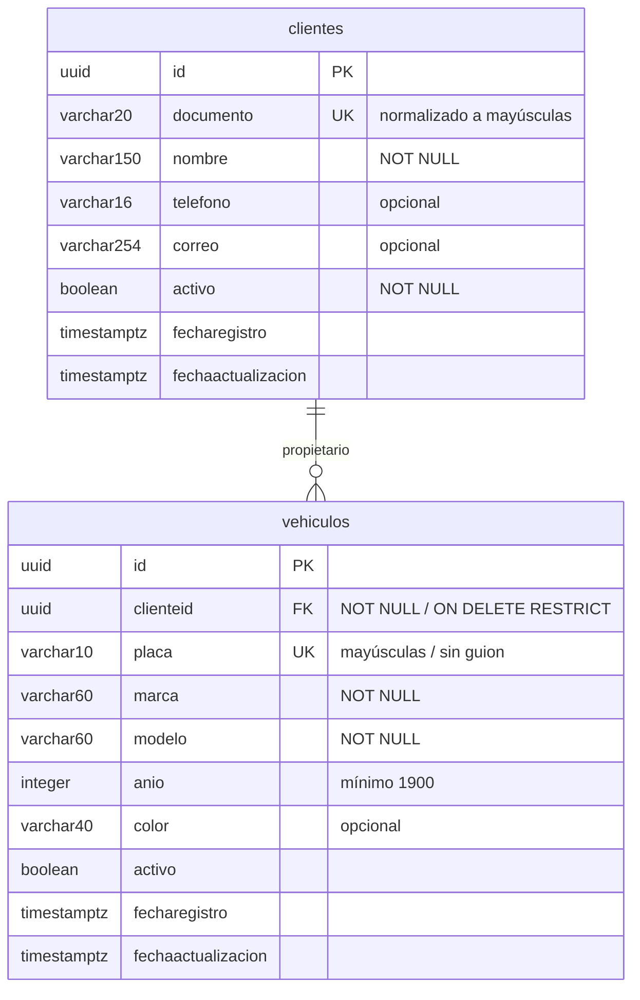
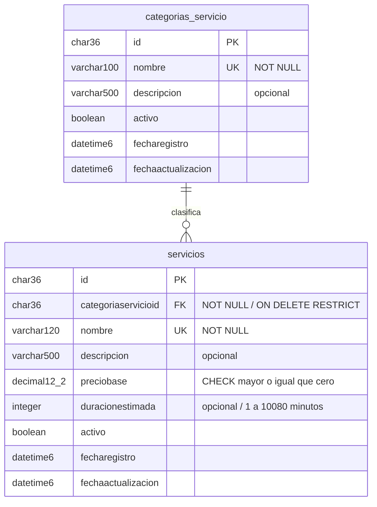
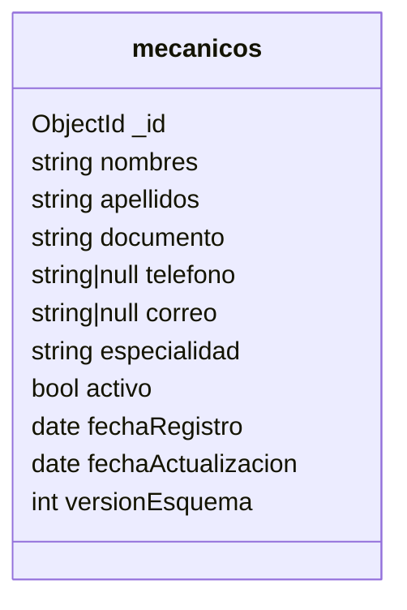

# Bases de datos y reglas

## P1 · PostgreSQL

Script preparado: `microservices/clientes-vehiculos/AutoTallerPro.ClientesVehiculos.Infrastructure/Esquema/001_clientes_vehiculos.sql`.
Incluye transacción, `CREATE TABLE IF NOT EXISTS`, índices únicos por `upper(documento)` y `upper(placa)` e índice del propietario.
No se elimina un cliente con vehículos. Para eliminarlo, primero se eliminan o reasignan sus vehículos.
La baja física es explícita y se confirma en Razor; el campo activo permite conservar registros sin borrarlos.

CI/NIT: entre 4 y 20 caracteres alfanuméricos o guiones, iniciando con letra o número.
La regla de placa acepta de 3 a 5 caracteres alfanuméricos, un guion opcional y de 2 a 4 caracteres finales;
se guarda en mayúsculas y sin guion para impedir duplicados equivalentes.
Año entre 1900 y el próximo año; nombre hasta 150 caracteres; marca/modelo hasta 60; color hasta 40.
El propietario debe existir y estar activo al guardar el vehículo.

## P2 · MySQL

Script preparado: `microservices/servicios/AutoTallerPro.Servicios.Infrastructure/Esquema/001_catalogo_servicios.sql`.
Tablas InnoDB, claves UUID representadas en `char(36)` ASCII y datos `utf8mb4_0900_as_ci`.
Nombres únicos por tabla sin distinguir mayúsculas, conservando diferencias de acentuación.
Se rechaza el borrado de categorías utilizadas. La categoría debe existir y estar activa al guardar un servicio.
Precio en bolivianos, de 0 a 9999999999,99, con máximo dos decimales; no se redondea silenciosamente.
La duración es opcional; si se informa, va de 1 a 10080 minutos. Descripciones hasta 500 caracteres.
Los DDL de MySQL pueden confirmar implícitamente: el script es idempotente y no pretende ser una migración transaccional.

## P3 · MongoDB

Script preparado: `microservices/mecanicos/AutoTallerPro.Mecanicos.Infrastructure/Esquema/001_mecanicos.js`.
Colección propia `mecanicos` con validación JSON Schema para nuevas instalaciones,
índice único `ux_mecanicos_documento` e índice `ix_mecanicos_nombre` por apellidos/nombres.
El identificador externo es una cadena hexadecimal de 24 caracteres y se mapea a ObjectId en Infrastructure.
Documento normalizado a mayúsculas; nombres y apellidos hasta 80 caracteres.
Especialidades admitidas: Mecánica general, Electricidad, Diagnóstico y Carrocería.
El documento incluye `versionEsquema = 1`; leer campos adicionales es compatible mediante `BsonIgnoreExtraElements`.
El script no modifica el validador de una colección ya existente: una evolución exige revisión y autorización explícitas.
No hay usuarios, contraseñas ni roles almacenados en esta colección.

## Reglas comunes

Correo opcional válido de hasta 254 caracteres. Teléfono opcional de 7 a 15 dígitos, con `+` inicial opcional;
no se permiten espacios ni guiones telefónicos. Las cadenas se recortan y los opcionales vacíos se convierten a null.
Las fechas usan UTC con precisión de milisegundos, compatible con los tres proveedores.
Los DTO de entrada no permiten cambiar Id, fecha de registro ni fecha de actualización.
Los intentos inválidos no llegan a escritura; las restricciones de la base cubren duplicados y claves foráneas en carrera.
No existe borrado en cascada ni acceso a otras bases.

## Inicialización

Los scripts no se ejecutan al arrancar una API. Están preparados para revisión de P6 y autorización antes de aplicarlos a bases del equipo.
`IF NOT EXISTS` no repara esquemas preexistentes incompatibles ni limpia duplicados: esa situación requiere un cambio específico.
En esta entrega solo se ejecutaron sobre bases efímeras propias creadas para pruebas.
No se leyó ni modificó `.env`, y no se ejecutaron migraciones sobre bases existentes.
